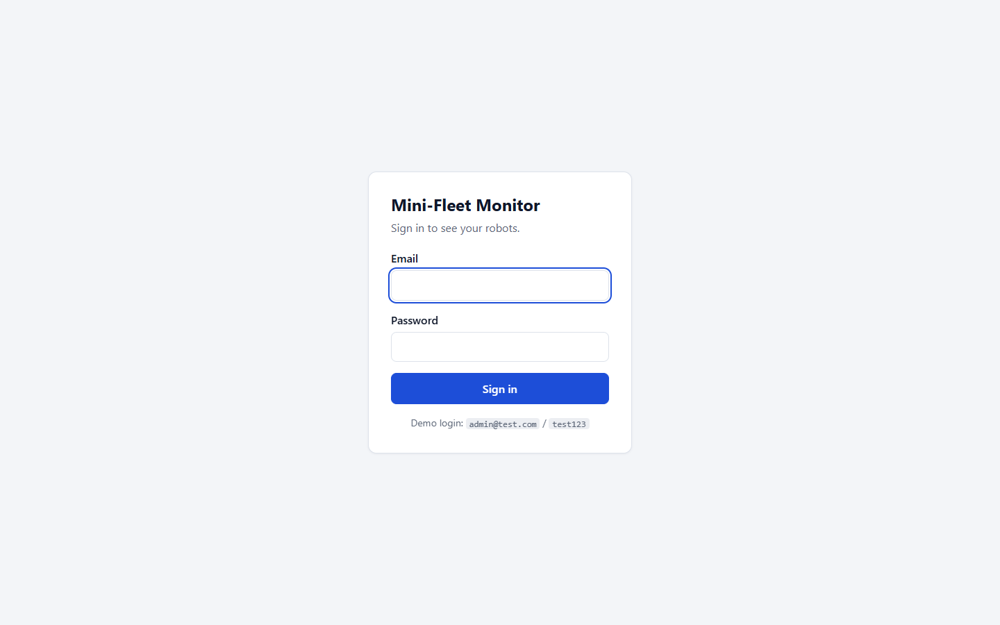
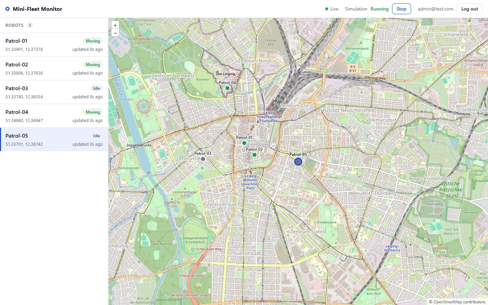

# Mini-Fleet Monitor

A small web application for monitoring a fleet of virtual robots: robots are listed and shown
on an OpenLayers map, their positions update live over a WebSocket, and everything sits behind
a JWT login. The scenario is a security-robotics control room, where an operator watches patrol
robots move through an area and needs to see at a glance which ones are moving and which are idle.

## Screenshots

| Login | Dashboard |
| --- | --- |
|  |  |

## Quick start

Requirements: Docker with Docker Compose v2. No `.env` file is needed, the defaults work out of the box.

```sh
docker compose up --build
```

The first build takes a minute or two. Once all containers are healthy:

| What | URL |
| --- | --- |
| Web app | http://localhost:5173 |
| API | http://localhost:3000 (health check at `/health/ready`) |
| WebSocket | ws://localhost:3000/ws |

Log in with the demo account **admin@test.com / test123**. The five patrol robots around Leipzig
start moving right away.

To stop:

```sh
docker compose down      # stops everything, keeps the database
docker compose down -v   # also deletes the database volume (next start re-seeds it)
```

**Port already in use?** Copy `.env.example` to `.env` and change the host ports: `POSTGRES_PORT`,
`REDIS_PORT`, `API_PORT` or `WEB_PORT` (for example `POSTGRES_PORT=5433` if a local Postgres is
running). The frontend build and the API's CORS setting follow `API_PORT` and `WEB_PORT`
automatically; run `docker compose up --build` again after changing them. Note that the
dockerized web app and `npm run dev` both use port 5173 by default, so only one of them can run
at a time.

## Architecture

The browser loads the React app from nginx and then talks to the API directly: REST calls with a
bearer token, plus one WebSocket for live updates. The API stores users, robots and position
history in Postgres and uses Redis for three things: a short-lived cache of the robot list, the
simulation on/off flag, and Pub/Sub. The simulator is a separate process built from the same image;
every 2 seconds it moves each robot inside a database transaction and publishes the new position
on Redis. Every API instance subscribes to that channel and forwards the message to its WebSocket
clients, so the simulator never needs to know who is connected.

```
                +---------------------------------------------+
                |  Browser: React + OpenLayers                |
                |  (static files from nginx, port 5173)       |
                +----------+-------------------------^--------+
                           |                         |
               REST + JWT  |                         |  WebSocket /ws?token=...
                           v                         |  {type:"robot"} {type:"simulation"}
                +----------+-------------------------+--------+
                |  api  (Express 5, port 3000)                |
                |  auth, robots, history, simulation control, |
                |  websocket server, migrations + seed        |
                +-----+-------------------+--------------^----+
                      |                   |              |
                  SQL |   cache robots:all |              | SUBSCRIBE robots:updates,
                      |  simulation:running|              |           simulation:state
                      v                   v              |
                +-----+------+     +------+--------------+----+
                |  Postgres  |     |  Redis                   |
                |  users,    |     |  cache, state, Pub/Sub   |
                |  robots,   |     +------^-------------------+
                |  positions |            |
                +-----^------+            | PUBLISH robots:updates
                      |                   | GET simulation:running
                      | UPDATE + history  |
                +-----+-------------------+----+
                |  simulator (every 2 s)       |
                |  same image, no HTTP port    |
                +------------------------------+
```

Startup order is enforced with healthchecks: Postgres and Redis, then the API (which runs the
migrations and the seed before it reports healthy), then the simulator and the web container.

## Requirements checklist

### Muss-Kriterien
- [x] Backend: Node.js + Express, PostgreSQL, Redis (cache and Pub/Sub)
- [x] JWT login with protected routes (middleware checks the token)
- [x] HTTP with CORS (restricted to the frontend origin)
- [x] REST + WebSocket for server-client communication
- [x] Docker Compose with Postgres and Redis (plus api, simulator and web)
- [x] Frontend: React (JavaScript) with HTML/CSS
- [x] OpenLayers map, login page and protected dashboard
- [x] Robots shown as markers with live position updates
- [x] Data model: `users` (id, email, password_hash, created_at) and `robots` (id, name, status idle|moving, lat, lon, updated_at)
- [x] `POST /auth/login`, `GET /robots` (protected), `POST /robots/:id/move` (random new position)
- [x] Moves run automatically: the simulator calls the same move logic every 2 seconds,
      updates the database and broadcasts the position over WebSocket
- [x] Robot list next to the map (name, status, last position)
- [x] `docker compose up` starts api, db, redis and the frontend
- [x] Demo user admin@test.com / test123
- [x] README with setup steps, architecture and screenshots

### Optional
- [x] `POST /robots` to add a robot
- [x] Redis cache for `GET /robots` (TTL 10 s)

### Bonus
- [x] Redis Pub/Sub instead of in-memory broadcast
- [x] Position history (`robot_positions`, `GET /robots/:id/positions`)
- [x] Start/Stop simulation buttons in the frontend
- [x] Deployable with Dockerfiles + docker-compose (nginx for the frontend)

### Extras
- Automated tests (unit + API integration), WebSocket token expiry, reconnect with backoff,
  graceful shutdown, healthchecks and startup ordering


## API

All routes except `/health` and `/auth/login` need `Authorization: Bearer <token>`.
Errors are returned as `{ "error": "...", "details": ... }`; validation errors are `400` with the
zod issues in `details`.

| Method | Path | Body / query | Response |
| --- | --- | --- | --- |
| GET | `/health` | | `{ status, uptime }`, liveness |
| GET | `/health/ready` | | `{ status, checks: { postgres, redis } }`, `503` if a dependency is down |
| POST | `/auth/login` | `{ email, password }` | `{ token, user: { id, email } }`, `401` on wrong credentials |
| GET | `/robots` | | `[{ id, name, status, lat, lon, updated_at }]`, cached for 10 s |
| POST | `/robots` | `{ name, lat?, lon? }` | `201` with the robot, `409` if the name exists; random point near Leipzig if no position is given |
| POST | `/robots/:id/move` | | the moved robot, `404` if it doesn't exist |
| GET | `/robots/:id/positions` | `?limit=50` (1 to 500) | `[{ lat, lon, status, recorded_at }]`, newest first, `404` if the robot doesn't exist |
| GET | `/simulation` | | `{ running }` |
| POST | `/simulation/start` | | `{ running: true }` |
| POST | `/simulation/stop` | | `{ running: false }` |

The three simulation routes answer `503` while Redis is unavailable. `status` is `moving` or `idle`. Tokens expire after `JWT_EXPIRES_IN` (default `1h`).

### WebSocket

Connect to `ws://localhost:3000/ws?token=<jwt>`. The server only sends; messages are JSON:

```json
{ "type": "simulation", "running": true }
```

Sent right after connecting and whenever the simulation is started or stopped.

```json
{
  "type": "robot",
  "robot": { "id": 1, "name": "Patrol-01", "status": "moving", "lat": 51.33971, "lon": 12.37319, "updated_at": "2026-10-19T09:42:59.702Z" }
}
```

Sent for every move, by the simulator or by `POST /robots/:id/move`.

Close codes: `4401` for a missing, invalid or expired token (also sent the moment a token expires
on an open connection), `1001` when the server shuts down. The server pings every 30 seconds and
drops connections that don't answer.

## Design decisions and trade-offs

**Migrations with an advisory lock.** Plain numbered SQL files in `api/migrations` are applied once
and recorded in `schema_migrations`. The API takes a Postgres advisory lock before migrating, so
several API containers starting at the same time don't run the same migration twice. Applied
migrations are never edited; changes go into a new file.

**Cache-aside with a 10 second TTL, live data over the WebSocket.** `GET /robots` reads
`robots:all` from Redis and falls back to Postgres on a miss. Creating a robot deletes the key, but
moves deliberately don't: the list is only the initial snapshot, live positions arrive over the
WebSocket, and invalidating on every tick would make the cache useless. The frontend merges by
`updated_at` and keeps the newer version of each robot, so a slightly stale snapshot never moves a
marker backwards. If Redis is down, the cache helpers skip it immediately instead of waiting for a
reconnect, and requests go straight to the database.

**One transaction per move, publish after commit.** A move reads the robot with `SELECT ... FOR
UPDATE`, updates it and writes a history row in one transaction. The row lock serializes a manual
move and a simulator tick on the same robot. The update is published only after the commit, so
clients never see a position that was rolled back.

**Pub/Sub is at-most-once.** Redis Pub/Sub doesn't store messages: a client that is disconnected,
or an API instance restarting, misses updates. That is acceptable here because the next tick sends
a fresh position, and the frontend reloads the snapshot after every reconnect. Anything that must
not be lost would need Redis Streams or a queue.

**Separate simulator service.** Running the simulation inside the API would make every extra API
instance move the robots again. As its own service it runs exactly once, can be restarted
independently and doesn't compete with HTTP requests. It uses `setTimeout` chaining rather than
`setInterval`, so a slow tick can never overlap with the next one.

**JWT in localStorage, token in the WebSocket URL.** The token is kept in `localStorage` so a reload
keeps the session. The cost is that any script injected through an XSS bug could read it; an
httpOnly cookie would avoid that but needs CSRF protection. Browsers can't set headers on a
WebSocket handshake, so the token goes in the query string, which means it can end up in proxy
access logs. The API doesn't log handshake URLs.

**Timing-safe login.** An unknown email still runs a bcrypt comparison against a dummy hash, so it
takes as long as a wrong password and the response time doesn't reveal which accounts exist. Both
cases return the same `401 Invalid email or password`. JWT verification pins `HS256`, which rules
out `alg: none` tokens.

## Local development without Docker

Postgres and Redis still come from Docker; the API, simulator and frontend run on the host with
hot reload. Node 22 is required.

```sh
docker compose up -d db redis
```

API (terminal 1) and simulator (terminal 2), from `api/`:

```sh
cd api
npm install
export JWT_SECRET=dev-only-change-me-please-32-chars-min   # PowerShell: $env:JWT_SECRET="..."
npm run dev                # http://localhost:3000, runs migrations and seed on start
node src/simulator.js      # in the second terminal, with the same JWT_SECRET
```

`DATABASE_URL` and `REDIS_URL` default to the ports Docker Compose publishes on localhost.

Frontend (terminal 3), from `web/`:

```sh
cd web
npm install
npm run dev                # http://localhost:5173
```

`VITE_API_URL` and `VITE_WS_URL` can be set in `web/.env` (see `web/.env.example`).

### Tests

```sh
cd api && npm test
```

This runs the unit tests for the movement logic and the API integration tests (login success,
wrong password, unknown email, `GET /robots` with and without a token). The integration tests need
the Postgres from `docker compose up -d db redis`; if it isn't reachable they are skipped with a
message instead of failing or hanging. Set `DATABASE_URL` to use a different database.

```sh
cd web && npm run lint && npm run build
```

## What I would do next for production

- **Retention for position history.** At five robots every two seconds the table grows by about
  200,000 rows a day. A scheduled job that deletes old rows, or monthly partitions that can be
  dropped, would keep it bounded.
- **Rate limiting on login,** per IP and per account, to slow down password guessing.
- **httpOnly cookies instead of localStorage,** with CSRF protection, and a short-lived WebSocket
  ticket instead of the JWT in the URL.
- **HTTPS and WSS** behind a reverse proxy, serving the frontend and API from one origin so CORS
  is no longer needed.
- **Own tile server or a commercial tile provider.** The public OpenStreetMap servers only allow
  light use.
- **Monitoring:** metrics for request latency, connected WebSocket clients and simulator tick
  duration, structured logs shipped to a central place, and alerts on `/health/ready`.
- **Secrets and configuration** from a secret store rather than compose defaults; the default
  `JWT_SECRET` is for development only.
